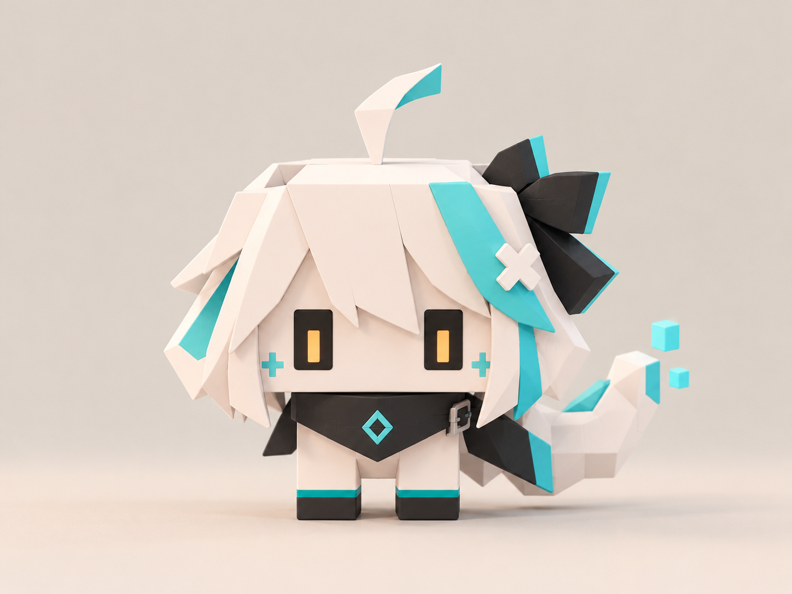

  

<h1 align="center">Grace</h1>

  

**Write your rules once. Grace carries them to every AI and proves where any rule got lost: at load, at compaction, or in a hand-off.**

> **Status:** early development (Milestone 0). Not ready to install yet. See [docs/STATUS.md](docs/STATUS.md).

Grace is a local-first companion for people who work with many AIs: Claude Code, Codex, local models and web chats. It's free, needs no account and sends no telemetry. Your sessions never leave your computer.

## For contributors

- What we're building: [docs/GRACE_SPEC.md](docs/GRACE_SPEC.md)
- How it looks and sounds: [docs/DESIGN.md](docs/DESIGN.md)
- Rules for AI agents working here: [AGENTS.md](AGENTS.md)

## License

[Apache-2.0](LICENSE)
